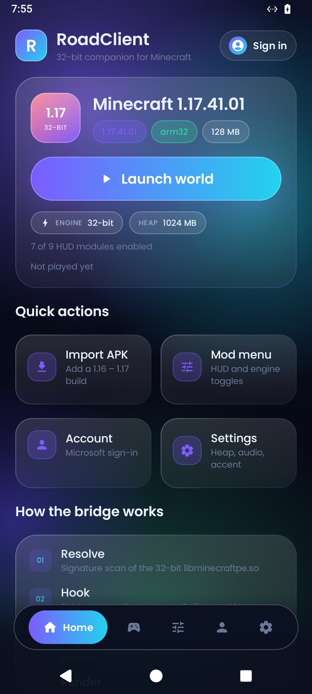
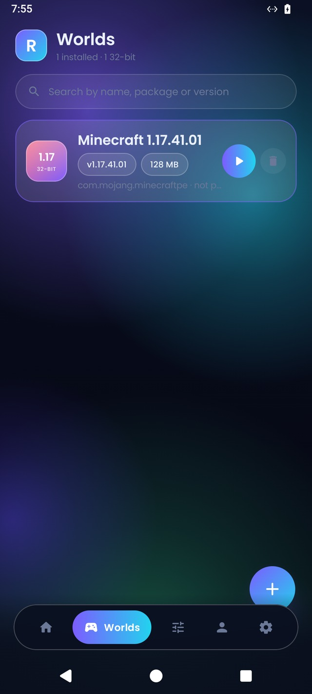
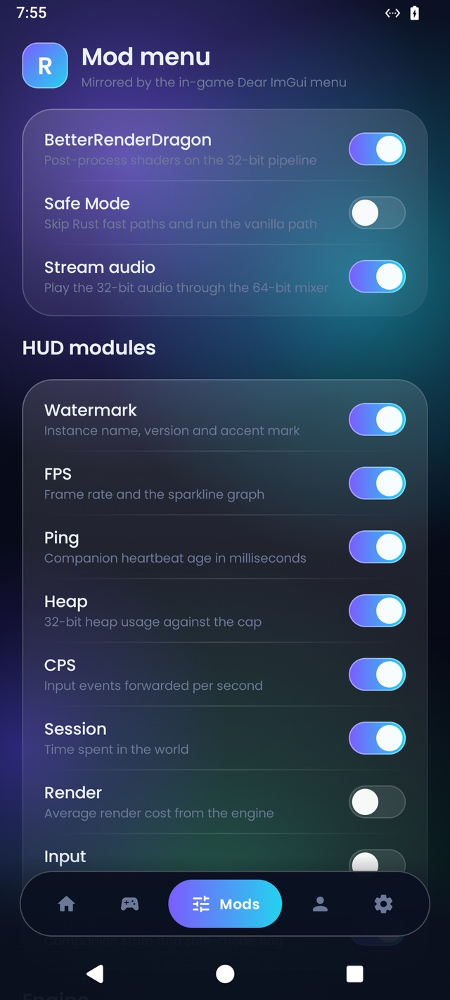
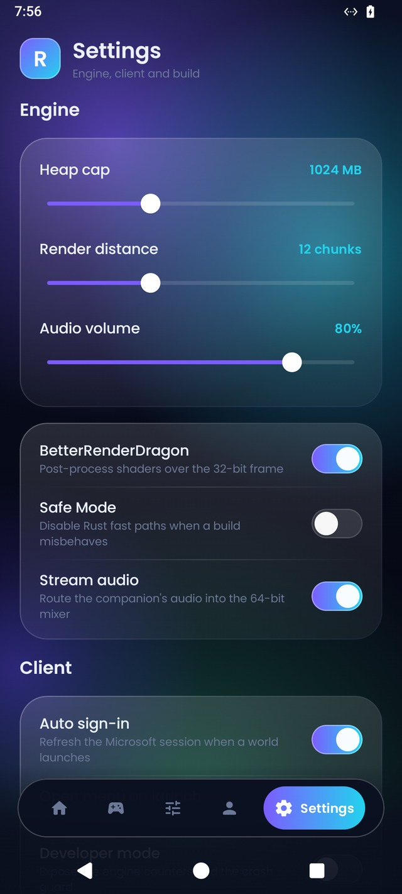
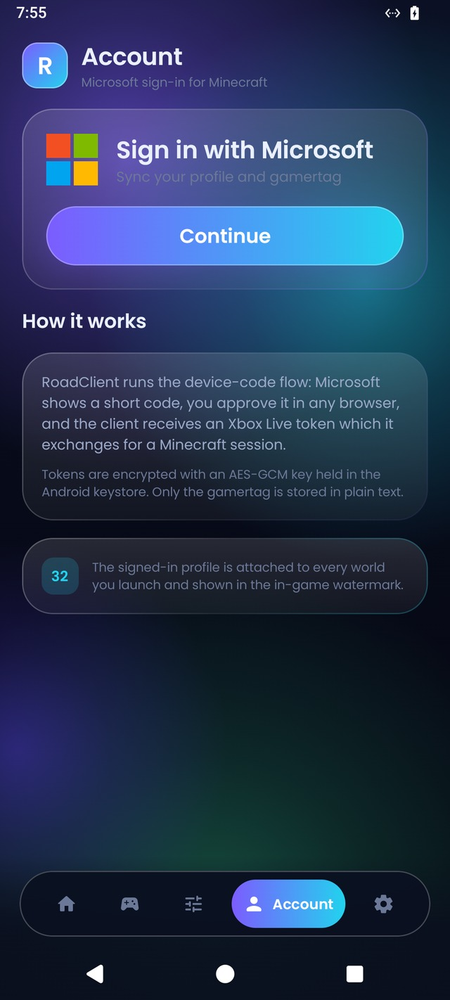
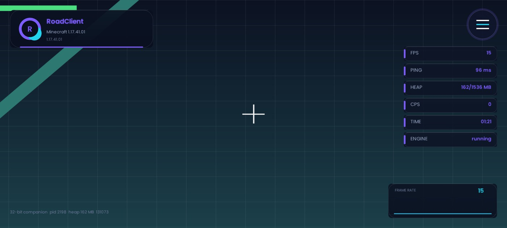
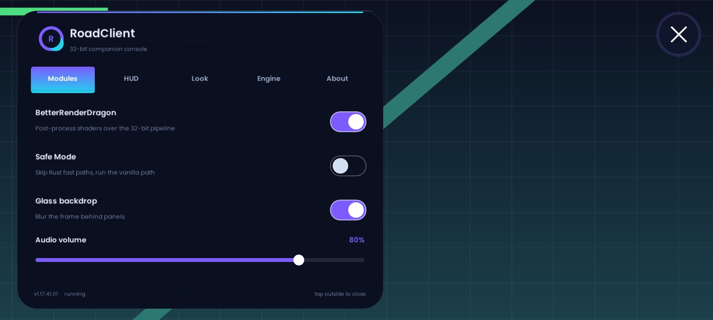
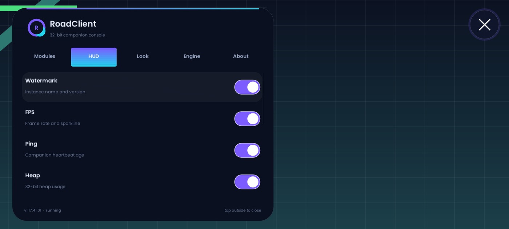
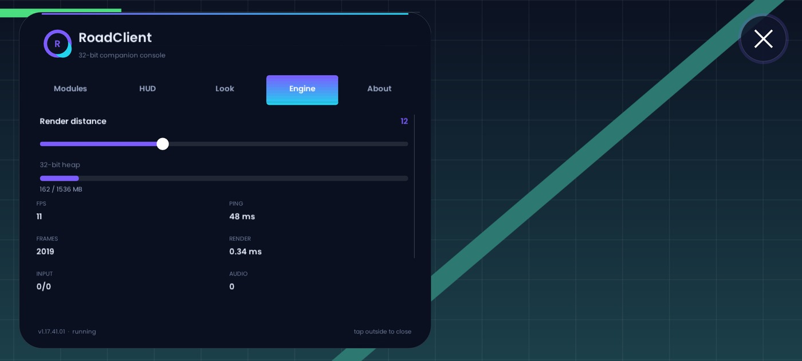
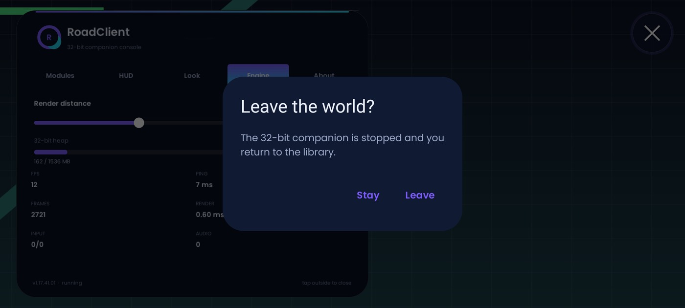

# Screenshots

Captured on a Motorola `clo200` cloud phone (Android 11, 1080 x 2400) running
the debug build with Minecraft 1.17.41.01 imported. The launcher is portrait,
the game surface is landscape, and the 32-bit companion is the only thing
drawing inside it - the overlay in the corner is Dear ImGui, not Compose.

## Launcher

| Home | Worlds |
| --- | --- |
|  |  |
| Instance card with the engine, heap and HUD summary; quick actions; a short explainer of the bridge. | Imported builds with version, ABI and size. The play button launches the companion. |

| Mods | Settings |
| --- | --- |
|  |  |
| The same switches the native console exposes, mirrored into Compose and persisted together. | Heap cap, render distance and audio level feed the companion at launch; the module toggles follow. |

Device-code sign-in. The token is sealed with an AES-GCM key in the Android
keystore; only the gamertag is stored in plain text.

## In game

The HUD is drawn by the 32-bit companion's ImGui context: watermark card,
frame rate sparkline, ping from the heartbeat, heap against the 1536 MB cap,
CPS, session time and engine state. Every value comes back over the shared
memory bridge.

| Modules | HUD |
| --- | --- |
|  |  |
| BetterRenderDragon, Safe Mode, glass backdrop and the audio level. | Per-element visibility for the watermark and the stat cards. |

Live engine telemetry: render distance, heap, FPS, heartbeat age, frame count,
render cost, forwarded input events and audio voices.

Back asks before it stops the companion, so the 32-bit process is never left
orphaned behind the launcher.
